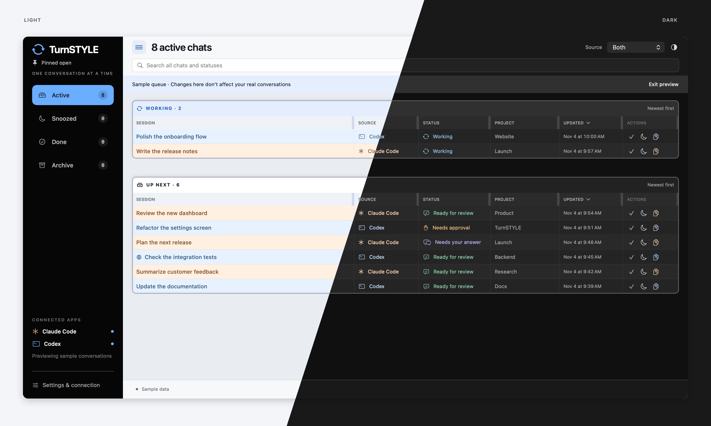

# TurnSTYLE

Beta 0.4.2 · MIT licensed

A free, local macOS queue for Claude Code and Codex chats. Keep it in a narrow
window beside your coding apps, see what is working or waiting, and open the exact
chat from its title. Native SwiftUI/AppKit, macOS 14+, with no third-party runtime
dependencies or model API calls.



*Actual app views with sample conversations. Light and dark modes shown together.*

## Features

- Active view with separate Working and Up Next tables; Snoozed, Done and Archive.
- Search across every status; filter Claude Code, Codex, or both.
- Compact, sortable tables with remembered column widths and drag-to-reorder
  headers. Table frames fit the window while headers/cells scroll horizontally.
- Light, neutral black/gray Dark, or System appearance. Claude and Codex have
  distinct title colors; a globe identifies remote chats.
- Snooze for 30 minutes, two hours, tomorrow at 9 AM, or indefinitely.
- Menu bar count, Dock badge, and optional macOS reminders.
- Optional Always on top setting, remembered across launches.
- Exact chat links, local hook status updates, and read-only history discovery.

On the first import, the five most recently updated eligible chats stay visible;
older ones go to TurnSTYLE's recoverable Archive. This happens once. There is no
ongoing chat-count limit. A new local prompt restores an archived/done/snoozed chat.
Background Claude SDK jobs, command-only sessions and subagents are excluded.
TurnSTYLE's queue choices do not archive or modify chats in the provider apps.

## Build and verify

Use a Swift 6 toolchain on macOS. See [CONTRIBUTING.md](CONTRIBUTING.md) for the
complete validation workflow.

```sh
swift run --build-system native TurnStyleChecks
zsh scripts/build.sh
python3 scripts/check-helper.py
python3 scripts/check-codex-helper.py
python3 scripts/check-remote-bridge.py
```

The build keeps compiler caches on the local disk, assembles and signs in a local
temporary folder, then creates
an architecture-specific ZIP in `dist/`. Extract the ZIP on a local disk, then move
the app to a permanent location (such as `/Applications`) **before installing hooks**:
the hook commands point into its bundle. Builds are ad-hoc signed and are not
notarized release binaries. A downloaded beta may require explicit approval in
macOS Privacy & Security. There is no automatic update or launch-at-login setup.

## Connect local chats

1. Launch TurnSTYLE and open Settings & connection.
2. Install Claude hooks, Codex hooks, or both. Defaults are `~/.claude` and
   `CODEX_HOME` (when exported to TurnSTYLE), otherwise `~/.codex`. Settings allow
   choosing another configuration folder.
3. Review/trust new hook commands in the provider's hook-review interface where
   required. Restart affected sessions so the definitions load. TurnSTYLE never
   changes trust, permissions, managed policy or explicit hook disabling.
4. Send a harmless prompt and verify Working → Ready for review. Also check a
   question/approval, snooze/restore and a new prompt after marking a chat Done.

Installation preserves unrelated settings/hooks and retains an exact original
backup in the provider's `turnstyle-backups/` folder. The connection indicator
means definitions are installed; the last-event timestamp confirms delivery.

## Connected-device Codex chats

TurnSTYLE reads the remote chat catalog already synced to this Mac by Codex's
Control other devices connection. No extra remote helper, SSH, Tailscale changes,
or API key is required for names, timestamps and links. Keep Codex connected to
the other device.

**The catalog does not expose live remote running/approval state.** These chats
show Check status until a live signal is available. Remote catalog updates can
restore archived imported chats when their activity timestamp advances; they do
not provide the local hook lifecycle. Opening the title uses Codex's chat and
connected-host deep link.

The retained SSH bridge is experimental, inactive code, not a supported part of
normal setup. It is not presented in Settings or polled by the app.

## Data and limitations

The app stores session IDs, titles, paths, observed statuses and queue choices in
`~/Library/Application Support/TurnSTYLE/queue.json`, plus individual durable hook
events in `events/`. Files/directories use owner-only permissions. Full hook
payloads and conversation contents are not retained; a title may start as a
100-character prompt excerpt. See [SECURITY.md](SECURITY.md) before sharing logs.

- Hooks report events rather than a heartbeat; missed events can leave stale
  status. Restart/wake resets saved Working entries to Check status.
- Ready for review means a response finished, not necessarily that a reply is
  required. Later activity can move the chat back to Working.
- Title metadata, connected-device SQLite schemas and exact-chat URL routes are
  internal provider formats and may break after a provider update. Claude links
  resolve the CLI/hook ID to its native Desktop ID; missing mappings show an error.
- Supported question tools and available lifecycle hooks vary by provider version.
  Concurrent approvals without distinct request IDs cannot be distinguished fully.
- Reminders require permission and the app to be running. Installed hooks can
  collect events while the app is closed. No provider chats are changed by Done,
  Snooze or Archive in TurnSTYLE.

## Remove the integration

Use each provider's Disconnect button in Settings & connection, then restart
affected chats. This removes TurnSTYLE's hook entries while preserving unrelated
configuration and backups. Quit before deleting the app. Local queue data is kept
for reinstalling; remove it separately only if you no longer need it.

## Source layout

- `Sources/TurnStyleCore`: event adapters, queue transitions, persistence, hook
  installation, title/history readers and exact-chat link resolution.
- `Sources/TurnSTYLE`: native UI, menu bar, notifications and background readers.
- `Sources/TurnSTYLEHook`: quiet, bounded stdin collector that fails open.
- `Tests/TurnStyleCoreTests`: isolated executable regression checks.
- `scripts`: local packaging, icon generation, subprocess checks and experimental
  SSH bridge sources.

## License

[MIT](LICENSE). TurnSTYLE is an independent project, unaffiliated with Anthropic or
OpenAI. Claude and Codex names identify the apps it integrates with.
